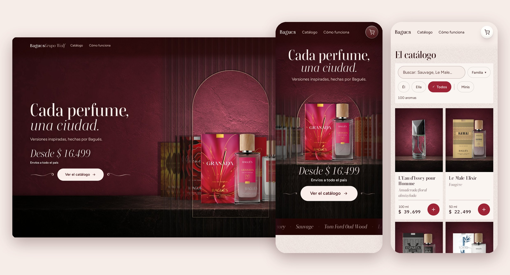

# Bagués Grupo Wolf

Tienda online y panel de gestión para mi venta de perfumes Bagués por WhatsApp,
en Córdoba.

**En producción:** https://baguesfraganciaswolf.vercel.app

## El problema

Vendo por catálogo y el catálogo cambia todos los meses: más de cien perfumes,
precios que se mueven, aromas que entran y salen. Cada cambio me llevaba una o
dos semanas entre precios, fotos y armar todo a mano.

**Hoy cargo un catálogo nuevo en menos de media hora.**

## Qué hace

- **Tienda:** cada perfume figura con el nombre que la gente ya conoce, con
  buscador que tolera errores ("savage", "good gril") y filtros por familia.
- **Ficha por perfume** con sus notas, tamaños y precios, y un link propio para
  compartir.
- **Pedido por WhatsApp:** la clienta arma el pedido y me llega escrito, listo
  para cargar. Sin pasarela de pago, a propósito: la venta se cierra hablando.
- **Panel privado:** pedidos, clientes y catálogo. Subo los PDF del ciclo nuevo,
  el panel me muestra qué cambia y recién con mi confirmación lo aplica.

## Con qué está hecho

React, Vite y React Router · CSS Modules, sin librerías de componentes ·
Supabase (PostgreSQL con seguridad por fila y login con Google) · Vercel.

## Cómo sé que funciona

- 94 pruebas automáticas que recorren la tienda como una clienta.
- Revisada en Safari, Chrome y Firefox antes de cada publicación.
- Velocidad en el celular: 97 en la portada (Lighthouse, contra producción).
- Los precios de cada pedido se buscan en la base, no se confía en el navegador.

## Errores que me enseñaron algo

- **En Chrome se veía perfecta y en un iPhone no.** El botón principal se salía
  de la pantalla. Desde entonces pruebo en los tres navegadores.
- **Durante días informé mal la velocidad.** Medía 86 contra un servidor de
  prueba; la tienda publicada daba 97.
- **Un cambio de precio iba a borrar datos de los pedidos.** Lo encontré antes
  de que pasara y ahora tiene su prueba.

## Lo que aprendí

- Verificar antes de afirmar, y medir donde falla, no donde es cómodo.
- El rendimiento es una decisión de diseño: compran desde un celular.
- Un sistema que agrega trabajo está fallado, por bien hecho que esté.
